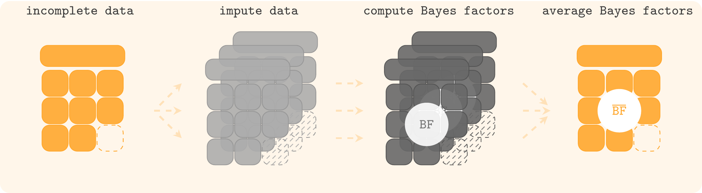
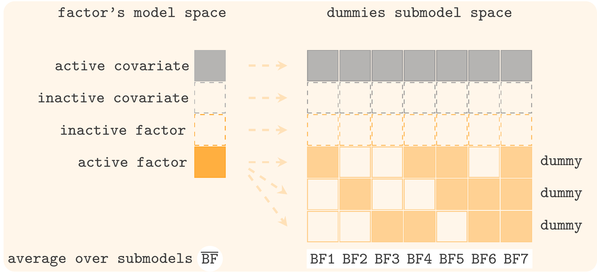
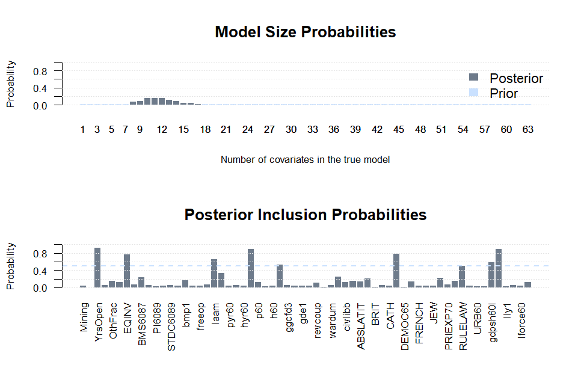

### `meantobvs` 

> Bayesian Variable Selection in the Presence of Missing Data and Factors: A Unified Framework

<br>

## Overview

<div align="justify">

`meantobvs` is an R package that implements Bayesian Variable Selection 
based on Bayes factors while incorporates other sources of uncertainty to the model
choice problem, such as missing data and factors. It includes hypothesis testing, model selection and
#' model averaging for either linear and generalized linear models.

The software is *meant to be the variable selection* solution for a broad range of 
problems. It applies to both linear and generalized linear models, through an 
intuitive interface, similar to the well-known `lm` and `glm` functions. 
The flexible implementation allows the advanced user to customize priors from a set 
of popular choices (Bayarri et al, 2012; Li and Clyde, 2018). Fast approximations such 
as the BIC (Schwarz, 1978) and TBF (Held, Sabanés and Gravestock, 2015) are also
available. Default choices are fully automatic and 
*meant for objective Bayesian variable selection*, while accounting 
for multiplicity issues (Scott and Berger, 2008). The process can be done through 
exact algorithms, to perform fast computations in problems of small to moderate size, 
and heuristic sampling methods to solve large complex problems. 

<br>

## Methodology

BVS

**When missingness occurs**, standard variable selection methods cannot be applied,
while multiple imputation procedures depend on the variables included, leading to 
a catch-22 situation. As other statistical areas, variable selection is not free
from the bias consequence of the missing mechanism.
In order to account for both sources of uncertainty, 
García-Donato et al. (2025) integrate missing data into the marginal likelihood. 
`meantobvs` implements this methodology in linear and generalized linear models 
via an average over the marginal of several imputed datasets. Thereby the derived model 
posterior becomes a weighted *mean to the Bayesian variable selection* method. 

<br>

<p align="center">

</p>

<br>

The posterior distribution over the model space is given through Bayes' theorem:
$$
P(M_i | {\tt{data}}) = P(M_i)\ AvB_i({\tt{data}})\ /\ C,
$$
where $AvB_i$ is the Average Bayes factor of $M_i$ to $M_0$ (null model) under missing data,
$P(M_i)$ is the prior probability of $M_i$ and $C$ is the normalizing constant.
$AvB_i$ is defined as the average of the corresponding data-driven standard BFs:
$$
AvB_i = [\ B_i({\tt{complete\ data}}_1)\ +\ ...\ +\ B_i({\tt{complete\ data}}_{\tt {n.imp}})\ ]\ /\ {\tt {n.imp}},
$$
where $B_i({\tt{complete\ data}}_j)$ corresponds to the BF for model $M_i$ to $M_0$ under the $j$-th imputed dataset.
Data-driven BF can be either computed using popular g-prior choices or approximated
with the BIC (Schwarz, 1978) or the test-based BF (Held, Gravestock and Sabanés, 2015).

In the **presence of categorical variables** (factors), the uncertainty regarding the levels
definition and its nature has not received so much attention. A naive approach makes
results highly dependent on the specification, usually somehow arbitrary, and changes
probabilities drastically, due to multiplicity issues (Scott and Berger, 2010). 
`meantobvs` by default assess factors themselves by averaging over the set of models
with at least one active dummy variable (García-Donato and Paulo, 2022):

<br>

<p align="center">

</p>

<br>

$$
P(M_i | {\tt{data}}) = P(M_i)\ B_i({\tt{data}})\ /\ C,
$$
where $B_i({\tt{data}}) = \sum_k P(M_{ik})\ B_k({\tt{data}})$ corresponds to the BF for model $M_i$ to $M_0$
if $M_i$ has an active factor and $M_{ik}$ are the submodel space made by the different
possible active levels of the factor. The methodology computes a posterior over the model space made
up by the factors, properly accounting for the reference level.

The posterior distribution can be summarized with its mode (the highest 
posterior probability model) and marginal posterior inclusion probabilities for 
each competing variable (a measure of relative importance) along with the
median probability model (Barbieri and Berger, 2004), to answer the user questions.

<br>

## Installing steps

To install the latest development version, you can use `install_github` from the `devtools` package:

```R
## install devtools if necessary
install.packages('devtools')
library(devtools)
## get the package from github
install_github('camulro/meantobvs', dependencies = TRUE)
```

<br>

## Usage

Perform variable selection on **linear regression models** as follows.

- Exhaustive enumeration of the model space defined by inclusion/exclusion of
the different variables specified by the full model.

```R
# Keep the eight models generated by three candidate covariates,
# BIC approximation for BF by default, few imputations for simplicity, real analyses need more.
f <- gr56092 ~ 1 + lifee060 + gdpsh60l + p60
dataS97.meantobvs <- bvs.lm(
   formula = f, data = dataS97, n.keep = 8, n.imp = 2, imp.seed = 1
)
```

```
NA values found on the response variable. We are going to omit these observations.
Performing imputation of missing data with mice's pmm method.
 Please wait . . . 

Info. . .
Most complex model has a total of 4 competing variables.
From those 1 is fixed (the intercept) and we should select from the remaining 3 
  Competing variables: lifee060 gdpsh60l p60 
The problem has a total of 8 competing models.
Of these, the  8 most probable (a posteriori) are kept.

[====================] 100% [Elapsed time: 00:00:00 | Estim. time: 00:00:00 | ≈ 967 models/s]
```

```R
#Show the results:
dataS97.meantobvs
```

```
Call:
bvs.lm(formula = f, data = dataS97, n.keep = 8, n.imp = 2, imp.seed = 1)

The 8 most probable models and their probabilities are:
  lifee060 gdpsh60l p60         Post
1        1        1   1 6.399756e-01
2        1        1   0 3.599838e-01
3        0        1   1 1.482610e-05
4        1        0   0 1.375163e-05
5        0        0   1 7.560726e-06
6        1        0   1 4.438623e-06
7        0        0   0 2.594974e-11
8        0        1   0 1.484217e-11
```

```R
#Summ up the results:
summary(dataS97.meantobvs)
```

```
Posterior Inclusion Probabilities:
         Incl.prob. HPM MPM
lifee060          1   *   *
gdpsh60l          1   *   *
p60            0.64   *   *
---
Code: HPM stands for Highest posterior Probability Model and
      MPM for Median Probability Model.
```

<br>

- Huge model spaces: approximation of the posterior model distribution through a 
Gibbs sampling algorithm.

```R
#Short chain for the example; real analyses need more iterations.
#Few imputations for simplicity, real analyses need more.
dataS97.meantobvs <- gibbsbvs.lm(
 formula = gr56092 ~ .,
 data = dataS97, n.iter = 200, n.burnin = 50, n.imp = 2,
 Gibbs.seed = 1, imp.seed = 1
)

#A plot with the posterior inclusion probabilities for each competing variable
#and the dimension probability of the true model:
plot(dataS97.meantobvs)
```
<br>

<p align="center">

</p>

<br>

- User given model space.

```R
#Define the list of competing models
models.list <- list(
   M0 = gr56092 ~ 1,
   M1 = gr56092 ~ lifee060,
   M2 = gr56092 ~ gdpsh60l,
   M3 = gr56092 ~ p60,
   M7 = gr56092 ~ lifee060 + gdpsh60l + p60
 )

#Few imputations for simplicity, real analyses need more.
dataS97.meantobtest <- btest.lm(
   data = dataS97, models = models.list, n.imp = 2, imp.seed = 1
)

#Show the results:
dataS97.meantobtest
```

```
-------
Competing models:
$M0
gr56092 ~ 1

$M1
gr56092 ~ lifee060

$M2
gr56092 ~ gdpsh60l

$M3
gr56092 ~ p60

$M7
gr56092 ~ lifee060 + gdpsh60l + p60

-------
log Bayes factors (expressed in relation to M0)
M0.to.M0 M1.to.M0 M2.to.M0 M3.to.M0 M7.to.M0 
   0.000   14.279    0.540   13.681   23.929 
-------
Posterior probabilities:
M0 M1 M2 M3 M7 
 0  0  0  0  1 
```

<br>

Perform variable selection on **generalized linear models** as follows.

- Exhaustive enumeration of the model space defined by inclusion/exclusion of
the different variables specified by the full model.

```R
#Indian Prime Diabetes Data
diabetes.meantobvs <- bvs.glm(
 formula = f, data = diabetes, family = binomial(), n.keep = 32,
 n.imp = 10, imp.seed = 1
)

#Show the results:
diabetes.meantobvs

#Summ up the results:
summary(diabetes.meantobvs)
```

<br>

- Huge model spaces: approximation of the posterior model distribution through a 
Gibbs sampling algorithm.

```R
#Default choices are: BIC approximation and ScottBerger prior.
#Use a short chain for the example; real analyses need more iterations.
#Few imputations for simplicity, real analyses need more.
diabetes.meantobvs <- gibbsbvs.glm(
 formula = Outcome ~  ., data = diabetes, family = binomial(),
 n.iter = 200, n.burnin = 50, n.imp = 2, Gibbs.seed = 1, imp.seed = 1
)

#Summ up the results:
summary(diabetes.meantobvs)
```

<br>

- User given model space.

```R
#Define the list of competing models
models.list = list(
   M0 = Outcome ~ 1,
   M1 = Outcome ~ Pregnancies,
   M2 = Outcome ~ Glucose,
   M3 = Outcome ~ Insulin,
   M4 = Outcome ~ Pregnancies + Glucose,
   M5 = Outcome ~ Pregnancies + Insulin,
   M6 = Outcome ~ Pregnancies + Glucose + Insulin
)

#Default choices are: BIC approximation and Constant prior.
#Few imputations for simplicity, real analyses need more.
diabetes.meantobtest <- mbtest.glm(
   data = diabetes, models = models.list, family = binomial(),
   n.imp = 2, imp.seed = 1
)


#Show the results:
diabetes.meantobtest
```

<br>

Other features:

```R
#To be completed...
```

<br>

## References


-   Barbieri, M and Berger, J. (2004).  Optimal Predictive Model Selection. 
    *The Annals of Statistics, 32*: 870-897. DOI:
    [10.1214/009053604000000238](https://doi.org/10.1214/009053604000000238)

-   Bayarri, M.J., Berger, J.O., Forte, A. and Garcia-Donato, G. (2012).
    Criteria for Bayesian Model choice with Application to Variable
    Selection. *Annals of Statistics, 40*: 1550-1577. DOI:
    [10.1214/12-aos1013](http://www.dx.doi.org/10.1214/12-aos1013)
    
-   van Buuren, S. and Groothuis-Oudshoorn, K. (2011). mice:
    Multivariate Imputation by Chained Equations in R. 
    *Journal of Statistical Software, 45*(3): 1–67. DOI:
    [10.18637/jss.v045.i03](https://doi.org/10.18637/jss.v045.i03)
    
-   Fernandez, C., Ley, E. and Steel, M.F.J. (2001). Benchmark priors
    for Bayesian model averaging. *Journal of Econometrics, 100*:
    381-427. DOI:
    [10.1016/s0304-4076(00)00076-2](http://www.dx.doi.org/10.1016/s0304-4076(00)00076-2)
    
-   García-Donato, G., Castellanos, M.E., Cabras, S., Quirós, A.
    and Forte, A. (2025). Model Uncertainty and Missing Data: An 
    Objective Bayesian Perspective (with Discussion). *Bayesian Analysis, 20*: 
    1677–1778. DOI:
    [10.1214/25-ba1531](https://doi.org/10.1214/25-BA1531)
    
-   Garcia-Donato, G. and Forte, A. (2018). Bayesian Testing, Variable
    Selection and Model Averaging in Linear Models using R with
    BayesVarSel. *The R Journal, 10*(1): 155–174. Retrieved from
    <https://journal.r-project.org/archive/2018/RJ-2018-021/index.html>
    
-   Garcia-Donato, G. and Martinez-Beneito, M.A.(2013). On sampling
    strategies in Bayesian variable selection problems with large model
    spaces. *Journal of the American Statistical Association, 108*:
    340-352. DOI:
    [10.1080/01621459.2012.742443](http://www.dx.doi.org/10.1080/01621459.2012.742443)
    
-   Held, L., Sabanés Bové, D. and Gravestock, I. (2015). Approximate 
    Bayesian Model Selection with the Deviance Statistic. 
    *Statistical Science, 30*(2): 242-257. DOI:
    [10.1214/14-sts510](https://doi.org/10.1214/14-STS510)
    
-   Li, Y. and Clyde, M. (2018). Mixtures of g-priors in Generalized Linear 
    Models. *Journal of the American Statistical Association, 113*: 1828-1845.
    DOI: [10.1080/01621459.2018.1469992](https://doi.org/10.1080/01621459.2018.1469992)
    
-   Liang, F., Paulo, R., Molina, G., Clyde, M. and Berger, J.O. (2008).
    Mixtures of g-priors for Bayesian Variable Selection. 
    *Journal of the American Statistical Association, 103*: 410-423. DOI:
    [10.1198/016214507000001337](http://www.dx.doi.org/10.1198/016214507000001337)
    
-   Schwarz, G. (1978). Estimating the dimension of a model. 
    *The Annals of Statistics, 6*(2): 461–464. DOI:
    [10.1214/aos/1176344136](https://doi.org/10.1214/aos/1176344136)
    
-   Scott, J.G. and Berger, J.O. (2010). Bayes and empirical-Bayes multiplicity
    adjustment in the variable-selection problem. 
    *The Annals of Statistics, 38*: 2587–2619. DOI:
    [10.1214/10-AOS792](https://doi.org/10.1214/10-AOS792)
    
-   Zellner, A. and Siow, A. (1980). Posterior Odds Ratio for Selected
    Regression Hypotheses. 
    *Trabajos de Estadística y de Investigación Operativa, 31*: 585. DOI:
    [10.1007/bf02888369](http://www.dx.doi.org/10.1007/bf02888369)
    
-   Zellner, A. and Siow, A. (1984). *Basic Issues in Econometrics*.
    Chicago: University of Chicago.
    
-   Zellner, A. (1986). On Assessing Prior Distributions and Bayesian
    Regression Analysis with g-prior Distributions. In A. Zellner (ed.),
    *Bayesian Inference and Decision techniques: Essays in Honor of Bruno de Finetti*, 
    389-399. Edward Elgar Publishing Limited. DOI:
    [10.2307/2233941](http://www.dx.doi.org/10.2307/2233941)
    
</div>
<br>
    
Grant PID2022-138201NB-100 funded by
MICIU/AEI/10.13039/501100011033 and by ERDF/EU.

